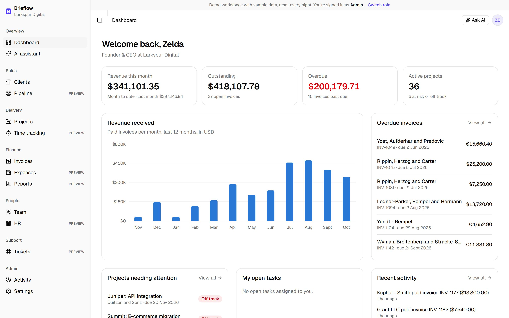
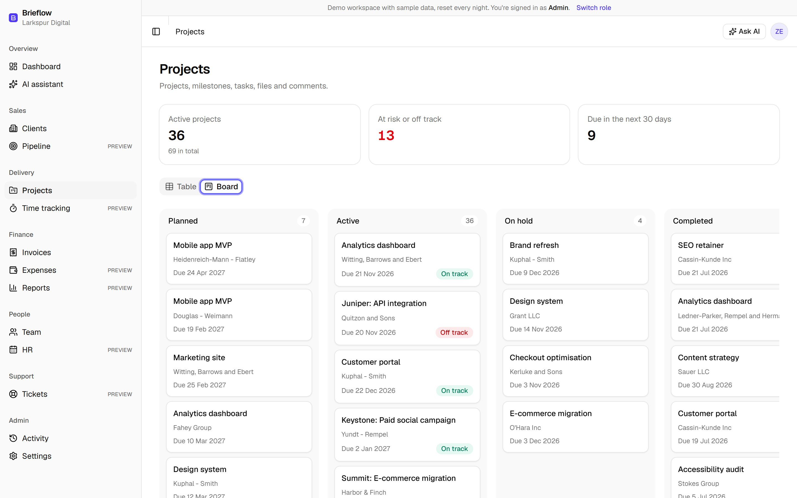

# Brieflow

An all-in-one operations platform for small digital agencies: clients, projects, invoices and payments, a client portal, team roles and an AI assistant.

**Live demo:** https://brieflow-ten.vercel.app · **Roadmap:** https://brieflow-ten.vercel.app/roadmap



> **This is a portfolio demo.** The agency, its staff and clients are invented, generated by a seed script, and the data resets every night. Payments run in Stripe test mode, or in a clearly labelled demo mode, and the AI assistant uses free-tier models. Modules marked **Preview** show real sample data read-only while they're being built.

## What this project shows

| If you need… | Where to look |
|---|---|
| A SaaS dashboard with roles and permissions | `src/server/authz/`, `/app/team` (the permissions matrix) |
| Multi-tenant data isolation | `scopeFor()` in `src/server/authz/scope.ts`, `tests/authz.test.ts` |
| An AI chatbot that answers questions about your data | `src/server/ai/`, `/app/assistant` |
| Stripe payments with webhooks | `src/server/payments/`, `src/app/api/stripe/webhook/` |
| Secure file uploads | `src/server/data/project-updates.ts`, `src/app/api/files/[id]/` |
| Third-party API integrations | Groq, Gemini, Stripe, Vercel Blob, Frankfurter, Nager.Date (`src/server/integrations/`) |
| A Next.js App Router backend without a backend-as-a-service | Server Actions, Route Handlers and a Data Access Layer on PostgreSQL |

## Try it in 90 seconds

1. Open the live demo and click **Try as Admin**. The dashboard shows revenue, what's overdue and projects at risk.
2. **Projects → Board**: open a project for its milestones, tasks, files and comments.
3. **Invoices**: open an open invoice and click **Mark as paid**; the activity log records who did it.
4. **Team**: scroll to **Roles and permissions**. This is the same table the server enforces.
5. Click **Switch role → Try as Client**. The client portal shows only Harbor & Finch's projects and invoices. Pay an invoice (test mode or demo).
6. Click **Ask AI** and ask "Summarise the latest comments on the Atlas project". One comment contains a prompt-injection attempt; the assistant treats it as data, and its tools can't reach other clients' data anyway.

## Features

**Working:** sign-in with one-click demo roles (admin, manager, accountant, staff, client) · dashboard with KPIs and a 12-month revenue chart · clients · projects (table and board) · invoices with multi-currency totals · mark invoices paid · online payment (Stripe test mode or demo mode) · client portal · comments · private file uploads · team and permissions matrix · audit log · AI assistant · nightly demo reset · integration status page.

**Preview (read-only sample data):** sales pipeline · time tracking · expenses and purchase orders · HR directory and leave (with live public holidays) · support tickets · reports.



## Architecture

**Stack:** Next.js 16 (App Router, React 19), TypeScript (strict), Tailwind CSS and shadcn/ui, PostgreSQL (Neon) with Drizzle ORM, Better Auth, TanStack Table, Recharts, Zod, Vitest, deployed on Vercel.

**Authentication.** Better Auth handles email and password sign-in and sessions (`src/server/auth/auth.ts`). There's no public sign-up: visitors use the demo buttons, which sign in server-side, so the demo password never reaches the browser. Sign-in is rate limited.

**Authorization: one rule, everywhere.**
- `getViewer()` returns who is asking: user, organization, role and, for client users, their client company.
- `src/server/authz/permissions.ts` is the single table of what each role may do. The Team page renders this same table.
- Every query lives in the Data Access Layer (`src/server/data/`). Each function checks the permission and adds `scopeFor(viewer, table)` to its WHERE clause: same organization always, and same client company for client users.
- An ESLint rule stops pages and components importing the database directly, so nothing can skip these checks.
- Records the viewer can't see return 404, not 403, so ids can't be probed.

**Multi-tenancy.** Every business table has `organization_id`. The seed creates a second agency purely so tests can prove the two never see each other's data.

**AI assistant** (`src/server/ai/`).
- **Providers:** an `AiProvider` interface with adapters for Groq (default) and Google Gemini (fallback when Groq is rate limited), both on their official SDKs.
- **Tools:** six read-only tools (clients, projects, invoices, revenue). Each calls the same Data Access Layer with the signed-in viewer, so the assistant can never see more than the person asking.
- **Prompt injection:** tool results are labelled as user-written data, and the system prompt forbids following instructions inside them. Even a model that obeyed would find nothing, because the tools can't reach other clients' data. Tests cover that case.
- **Limits and streaming:** up to four tool rounds, and answers stream to the browser as newline-delimited JSON. Daily per-user and global quotas are counted in Postgres to stay within the free tiers.

**Payments** (`src/server/payments/`). A `PaymentProvider` interface with two adapters: Stripe Checkout, which accepts test keys only, and a demo checkout.
- **Stripe webhook:** signature-verified and live mode refused.
- **One payment path:** manual, demo and Stripe payments all go through `recordInvoicePayment`. It locks the invoice and relies on a unique payment reference, so a retried webhook never records a payment twice.

**Files.**
- **Storage:** uploads go to Vercel Blob as private files. The type is detected from the file's bytes (PDF, PNG, JPEG, WebP), the limit is 2 MB and names are sanitised.
- **Downloads:** files go through `/api/files/[id]`, which checks project access first.

**Audit log.** Changes write an activity entry in the same transaction as the change itself.

**Nightly reset.**
- **Schedule:** Vercel Cron calls `/api/cron/reset`, protected by `CRON_SECRET`.
- **What it does:** rebuilds the sample data in one transaction, deletes the day's uploads, and fetches the day's European Central Bank exchange rates from Frankfurter.

## Run it locally

Requires Node 22 and pnpm 9 (this repo uses pnpm through corepack). No cloud accounts are needed.

```bash
corepack pnpm@9.15.4 install
cp .env.example .env.local        # set BETTER_AUTH_SECRET and DEMO_USER_PASSWORD
corepack pnpm@9.15.4 db:local     # local Postgres (PGlite); leave it running in its own terminal
corepack pnpm@9.15.4 db:migrate   # create the tables
corepack pnpm@9.15.4 db:seed      # load the demo data (and today's exchange rates)
corepack pnpm@9.15.4 dev
```

`.env.development` points the app at `db:local`. To use Neon instead, put a Neon `DATABASE_URL` in `.env.local`. Optional services, such as the AI keys, Stripe test keys and Vercel Blob, are listed in `.env.example`. Each one shows as "Not configured" in Settings → Integrations until it's set.

Other scripts: `corepack pnpm@9.15.4 test` (Vitest), `typecheck`, `lint`, and `screenshots` (recaptures the images in `public/screenshots` using the installed Microsoft Edge).

## Tests

The tests run against a real PostgreSQL running in memory (PGlite), with the migrations and seed applied, so they need no database server. They cover:

- **Access rules:** cross-client and cross-organization isolation, hidden budgets, drafts and internal comments, and role limits.
- **AI assistant:** a scripted stand-in model checks per-role tools, refused tools, isolation even when the model follows an injected instruction, provider fallback and the daily quota.
- **Payments:** own-invoice-only payments, idempotent Stripe handling, bad signatures and live-mode events refused.
- **Comments and uploads:** visibility rules, byte-level type detection and cross-client downloads refused.
- **Nightly reset and seed:** the reset restores the data, and the seed is consistent and deterministic.

---

Built by Maaz Ahmed.
